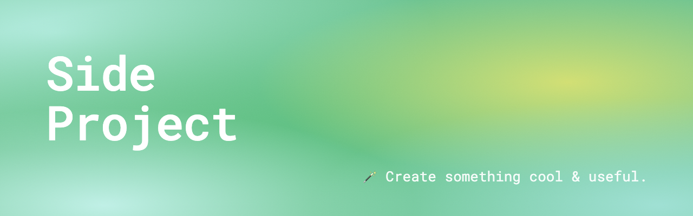
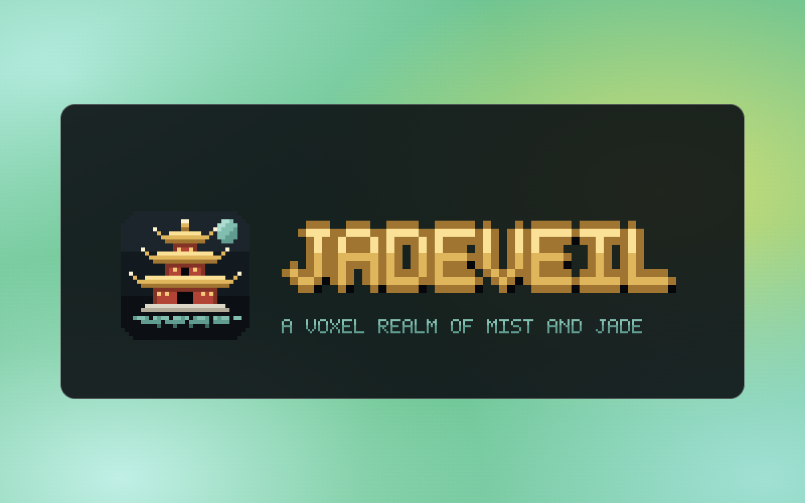
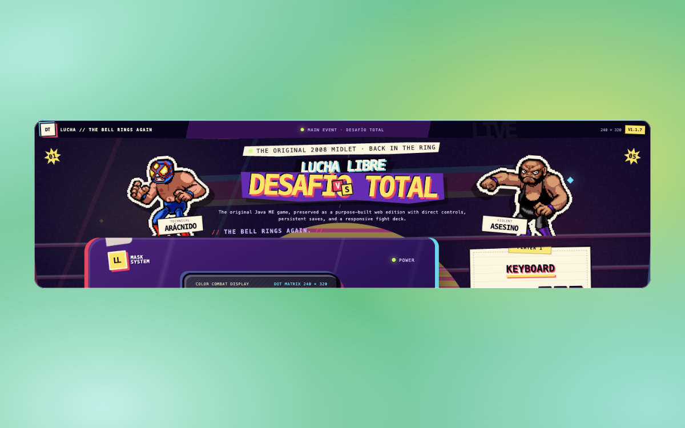
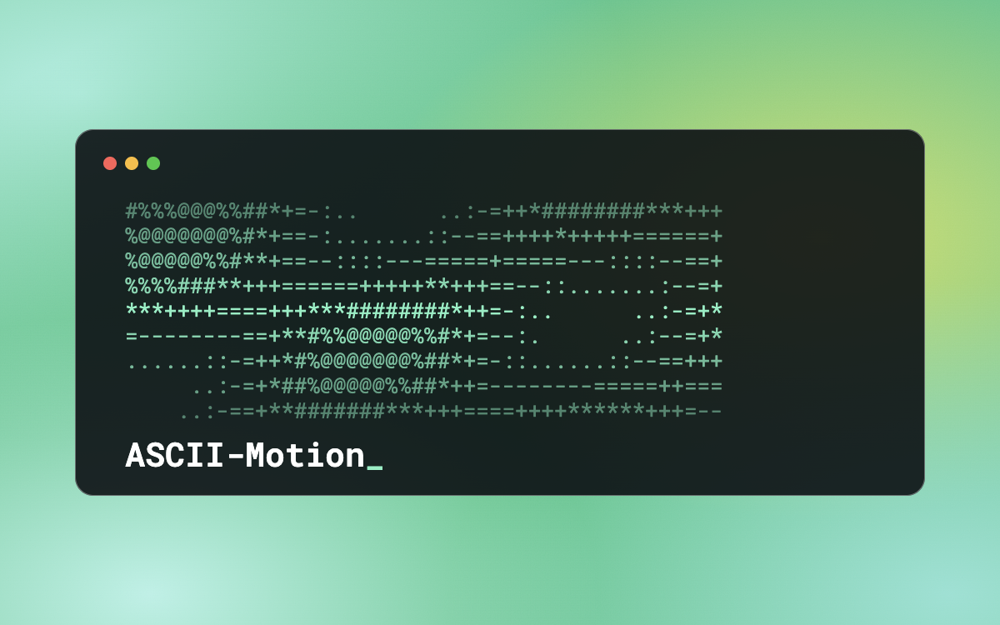

<a href="https://a-side-project.io">a-side-project.io</a>

<table>
  <tr>
    <td width="33%" valign="top">
      
      
<b><a href="https://github.com/a-side-project/jadeveil">jadeveil</a></b> <a href="https://jadeveil.xiaoa.name">jadeveil.xiaoa.name</a>

      
🏯 A Minecraft-styled single-player RPG in the browser — a Chinese voxel capital, JJ in a red hood and a rideable Ender Dragon. Pure three.js, zero build step.

    </td>
    <td width="33%" valign="top">
      
      
<b><a href="https://github.com/a-side-project/lucha">lucha</a></b> <a href="https://lucha.xiaoa.name">lucha.xiaoa.name</a>

      
🎮 Purpose-built browser edition of Lucha Libre: Desafío Total, preserving the original Java ME MIDlet in a responsive desktop, phone and tablet shell.

    </td>
    <td width="33%" valign="top">
      
      
<b><a href="https://github.com/a-side-project/ASCII-Motion">ASCII-Motion</a></b> github.com/a-side-project/ASCII-Motion

      
💗 Professional ASCII animation design tool - a fascinating AI-human collaboration project with 100% AI-generated 🤖 code

    </td>
  </tr>
</table>
